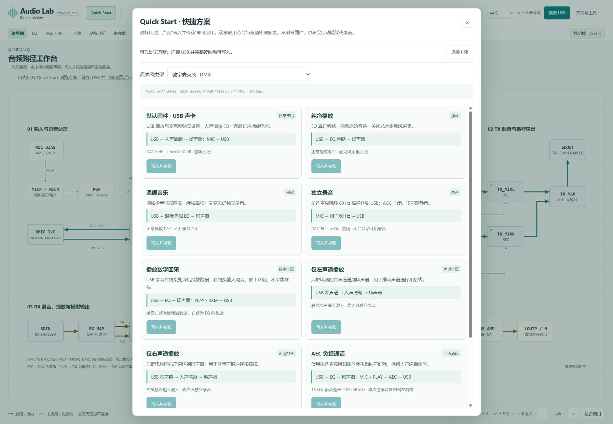

# AC101S digital microphone

[中文](DMIC.md) | **English**

AC10x bridge firmware 0.4.0 and Audio Lab 0.8.16 provide AC101S digital microphone capture at 48 kHz. PDM input shares the downstream high-pass filter, AGC, digital gain and USB capture path. DMIC bypasses the analog PGA and sigma-delta modulator; adjust its level in Recording volume.

## Evaluation-board wiring

Disconnect all power before changing connections. For this project's AC101S MIC3 interface:

| Point | DMIC connection |
|---|---|
| MICP | Clock output from Codec to microphone CLOCK |
| MICN | Data input from microphone DATA |
| H32 | Short to power MIC3 |
| H33 | 4–3 for clock; 1–2 for data |
| H34 | 1–2, AGND selection |
| H29 | Remove both analog microphone signal jumpers |
| C34 | Leave unpopulated; it bridges the shared inputs even with H29 removed |

Use the microphone's rated supply and a common ground. The H28 analog bias supply does not power the digital microphone. Analog and digital inputs share MICP/MICN and must not be connected simultaneously.

To return to ECM, disconnect all power, disconnect the digital clock/data connections and restore the MIC1/H28/H29 [analog wiring](HARDWARE-SETUP.md). Restore analog filter components according to the board BOM, then select AMIC in the software.

## WebTools

1. Start the full workbench over local HTTP, connect the AC10x bridge, and choose the AC101S register map.
2. Open **Quick Start** and choose **Digital microphone · DMIC**.
3. Apply **Default firmware · USB sound card** to keep clear-vocal playback and independent DMIC recording, or choose **AEC hands-free call**.
4. Open Audition / Recording, list inputs, choose **AC10x Duplex** and start recording. New recordings display and export raw WAV by default; A/B is a browser audition control. Raw means the USB input: when AEC is enabled, this input contains the AEC result.

The selector alone never writes registers. All nine setups use the selected microphone. Free editing uses the AMIC/DMIC graph module and the usual verified write action. Analog PGA and bias controls are disabled for DMIC.

Boot retains the original AMIC default table and does not save this temporary choice to NVS. Reapply the selected microphone setup after power cycling. Clear-vocal EQ, DAC and Line Out at 0 dB, and normal AC10x Duplex playback are retained.

## Sample rates and AEC

USB, I²S and AC101S capture run at **48 kHz**, with a 12.288 MHz MCLK and Codec in slave mode. The Codec generates the PDM clock on MICP; the USB sample rate is not that electrical clock frequency.

The AC101S model supports 16/48 kHz DMIC; the bridge firmware uses fixed 48 kHz. AC102 retains its documented 8–24 kHz digital-input range. Do not use the AC101S 48 kHz setup for AC102. For earlier firmware, use Quick Start to check which input modes the bridge offers.

[AEC](AEC.md) accepts either selected input and a synchronous PLAY reference. It processes speech at 16 kHz and outputs 48 kHz USB audio. With AEC disabled, capture retains the raw 48 kHz microphone data.
