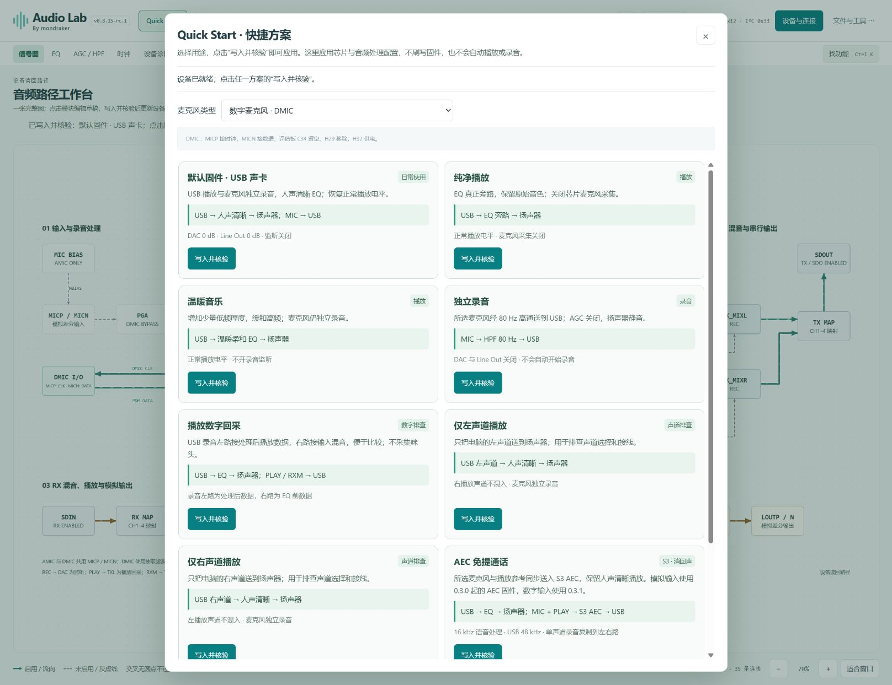

# AC101S 数字麦克风

**中文** | [English](DMIC.en.md)

S3 固件 0.3.1 与 Audio Lab 0.8.15 支持 AC101S 的 48 kHz 数字麦克风采集。麦克风通过 Codec 的 PDM 接口输入，后续高通、AGC、数字音量与 USB 录音通路继续共用。数字输入绕过模拟 PGA 和 ΣΔ 调制器；录音电平在“录音音量”模块调整。

## 评估板接线

改线前断开全部供电。以下接法用于本项目 AC101S 评估板的 MIC3 接口：

| 位置 | DMIC 接法 |
|---|---|
| MICP | Codec 输出时钟，接数字咪头 CLOCK |
| MICN | Codec 接收数据，接数字咪头 DATA |
| H32 | 短接，接通 MIC3 供电 |
| H33 | 4–3 接时钟；1–2 接数据 |
| H34 | 1–2，选择 AGND |
| H29 | 移除两组模拟麦克风信号跳帽 |
| C34 | 留空；它跨接在共享输入网上，不能只靠移除 H29 断开 |

数字咪头使用其额定电压供电并与板卡共地。H28 的模拟咪头偏置不作为数字咪头电源。MICP／MICN 共用引脚，不同时接模拟输入和数字咪头。

返回模拟 ECM 时，全断电后断开数字咪头的时钟／数据连接，恢复 MIC1、H28、H29 的[模拟接线](HARDWARE-SETUP.md)，模拟滤波元件按板卡 BOM 恢复，再在软件中选择 AMIC。

## 网页使用

1. 通过本地 HTTP 启动完整上位机，连接 S3，选择 AC101S 寄存器表。
2. 打开 **Quick Start**，麦克风类型选择 **数字麦克风 · DMIC**。
3. 选择“默认固件 · USB 声卡”并点击“写入并核验”，保留人声清晰播放和独立 DMIC 录音；需要通话时选择“AEC 免提通话”。
4. 打开“试听／录音”，列出设备并选择 **AC10x Duplex** 输入，开始录音。新录音默认显示和导出原始 WAV；A/B 仅用于浏览器试听。这里的原始信号指 USB 输入，启用 S3 AEC 时录到的是 AEC 结果。

选择麦克风类型本身不会写入芯片。九个快捷方案共用该选择；自由编辑也可从信号图的 AMIC／DMIC 模块切换，再按模块写入。PGA 和模拟偏置控件在 DMIC 模式下停用。

固件上电仍使用原模拟麦克风默认表，不将临时选择写入 NVS；重新上电后需要应用所用麦克风方案。电脑播放输出仍选择 **AC10x Duplex**，DAC／Line Out 的 0 dB 默认电平和人声清晰 EQ 不变。

## 采样率与 AEC

正式 S3 桥接器的 USB、I²S 和 AC101S 录音采样率均为 **48 kHz**，MCLK 为 12.288 MHz，Codec 为从机。MICP 上的 PDM 时钟由 Codec 产生，不能将 USB 采样率当成其电气时钟频率。

AC101S 参数模型提供 16／48 kHz DMIC；本 S3 固件固定使用 48 kHz。AC102 数字输入沿用其手册中的 8–24 kHz 范围，不能套用 AC101S 的 48 kHz 配置。TI、S31 和旧 S3 固件继续使用模拟输入。

[AEC](AEC.md) 同时支持所选模拟或数字麦克风，以同步 PLAY 数据作为参考。算法处理为 16 kHz 语音，USB 录音保持 48 kHz；AEC 关闭时保留原始 48 kHz 麦克风数据。
