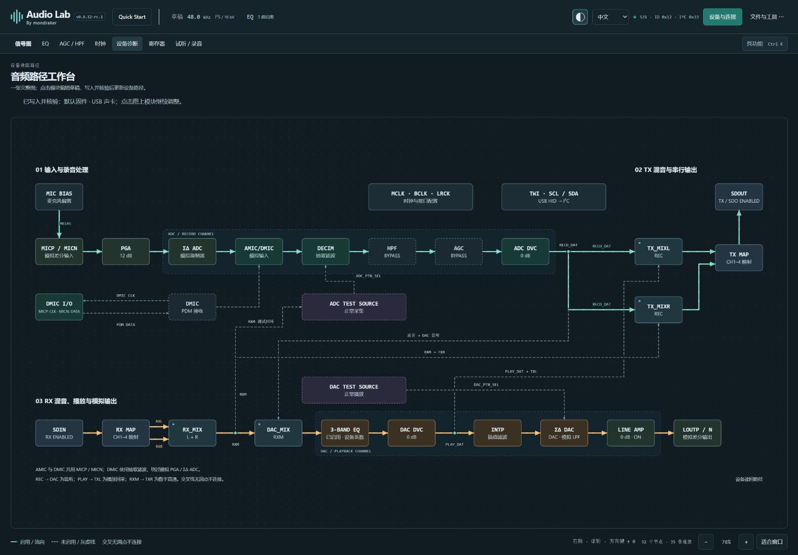

# AC10x Audio Lab

[中文](README.md) | **English**

**By mondraker**

A browser workbench for AC101S / AC102 audio configuration and debugging. Web release **0.8.12-rc.1**, default firmware **0.3.3**.

One complete signal diagram and one Quick Start entry, with register readback, verified writes, configuration comparison, diagnostics, and playback/recording tools. The interface supports Chinese and English, light and dark themes. The runtime requires no CDN or remote fonts.



## Getting started

Use desktop Chrome or Edge and Python 3. Serve the application over local HTTP:

```powershell
python qa/launch-http.py
```

Open `http://127.0.0.1:47881/`. The static server binds only to localhost and has no device-control backend. For a separate port, use `python qa/launch-http.py --port 47882`, after checking that the port is available.

1. Open **Device & connection** and select the USB bridge. Connecting reads registers without applying a configuration.
2. Open **Quick Start**, choose a configuration, and select **Write & verify**. This restores codec parameters; it does not flash firmware or start playback or recording.
3. Click a diagram module to edit its draft, then explicitly write and verify from the panel. Navigation, language/theme changes, and draft edits do not write to the device.

The default is a **USB soundcard with Clear vocal EQ**. DAC and Line Out are both at 0 dB. Microphone recording is independent, with recording-to-speaker monitoring and digital loopback disabled. EQ settings are 180 Hz at −3 dB, 2.5 kHz at +3 dB, 8 kHz at +1.5 dB, with −4 dB pre-gain. Start with a low computer volume when connecting a new amplifier. If playback is silent, check the system output device, mute state, and volume as well as codec settings.

Quick Start provides eight configurations: default USB soundcard, flat playback, warm music, independent recording, digital playback capture, left-channel playback, right-channel playback, and mute standby. The EQ module also has 16 presets. Disabling EQ writes unity coefficients for a true bypass while preserving the preset for restoration.

Right-drag to pan and use the wheel to zoom. Arrow keys pan, ± zooms, and 0 fits the diagram. Each diagram corner can move as far as the viewport center. Animated connections show enabled routes from device readback; they do not measure audio activity.

## Supported bridges

| Bridge | Current validation |
|---|---|
| Original TI bridge | Existing protocol and variable report sizes retained; software regression covered |
| S31 audio bridge | Real WebHID writes/readback, USB audio, and speaker path verified |
| ESP32-S3 candidate bridge | Software regression passed; no S3 hardware acceptance in this release |

S31 and the S3 candidate use 48 kHz, 16-bit samples, two 32-bit I²S slots, a slave codec, and a 12.288 MHz reference MCLK. External clocks must match the configuration. The TI bridge retains and validates its configured clocks.

The tested board is physically marked AC101S. Register ID 0x12 alone cannot distinguish AC101S from AC102. See [hardware setup](HARDWARE-SETUP.md). The [default firmware](firmware/README.md) is for the confirmed S31 application partition, not a generic image for arbitrary S3 boards or pin mappings.

## Development and regression tests

Use Node.js 18+ and Python 3:

```powershell
npm ci
npm run build
npm test
```

If the test runner cannot find Python, select it explicitly:

```powershell
$env:AC10X_PYTHON = (Get-Command python).Source
npm test
```

`npm test` uses fake devices, a synthetic DOM, and temporary local HTTP servers. It does not access real HID, USB, serial ports, microphones, or audio devices. Native hardware scripts require a separate test arrangement and are not part of the default test command.

Software acceptance covers **327 checks in 39 suites**, plus 104 property cases and 110 asynchronous scheduling cases. All eight corrected configurations passed native S31 transactions. Final production-page testing applied digital playback capture, obtained valid audio on both return channels, restored the default, and compared 104 readback registers against 83 masked patches with no differences.

The complete browser user-flow matrix was tested on 0.8.11-rc.2. Final testing on this release covers the corrected digital capture and default restoration. An external MiniMIC detected actual webpage A/B playback and speaker output. These results establish functionality and relative changes, not calibrated THD, SNR, or sound-pressure measurements. See the [validation summary](docs/validation-0.8.12-rc.1.json).

## Files and releases

- `index.html`, JavaScript, and CSS: maintainable source.
- `AC10x-Audio-Lab.html` and the versioned HTML: equivalent standalone builds, served over local HTTP.
- `qa/`: offline tests, protocol fixtures, build tools, and HTTP launchers.
- `firmware/`: S31 default firmware and matching source, with dependency licensing retained.
- [0.8.12-rc.1 complete package](releases/AC10x-Audio-Lab-0.8.12-rc.1.zip) and [SHA-256 checksums](releases/SHA256SUMS.txt). The original 0.8.5 archive is preserved.

The repository excludes the original commercial vendor application, user recordings, personal configurations, installed development dependencies, and personal Codex skills. No open-source license has been selected for this project; `package.json` remains `private: true` / `UNLICENSED`. See [third-party notices](THIRD-PARTY-NOTICES.md).
