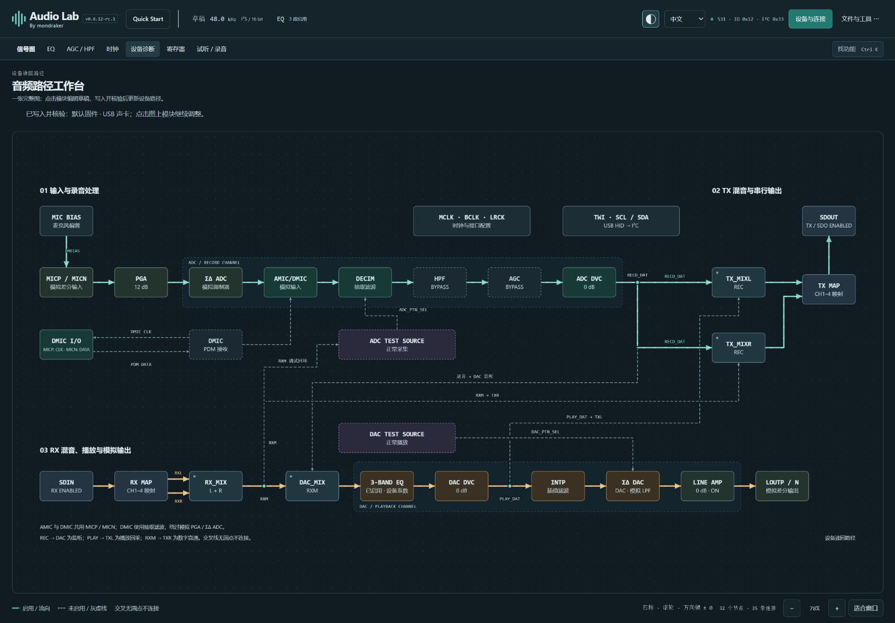

# AC10x Audio Lab

**中文** | [English](README.en.md)

**By mondraker**

面向 AC101S / AC102 的浏览器音频调试工作台。一张完整信号图，配合 Quick Start、寄存器读写、EQ、配置比较、诊断和试听／录音。

上位机 **0.8.14-rc.1**，配套固件 **S31 0.3.3 / ESP32-S3 0.3.0**。支持中文／English、浅色／暗色主题，运行入口内置全部 JavaScript 和样式。



## 开始使用

使用桌面版 Chrome / Edge 和 Python 3，在仓库根目录启动：

```powershell
python qa/launch-http.py
```

打开 `http://127.0.0.1:47881/`。

1. 点击“连接 USB”，选择对应桥接器并读回参数。
2. 打开 **Quick Start**，选择用途，点击“写入并核验”。
3. 点击信号图模块调整参数，在面板底部写入并核验。

默认配置为 **USB 声卡 + 人声清晰 EQ**：DAC 和 Line Out 均0dB，麦克风独立录音，录音监听和数字回环关闭。人声清晰参数为180Hz −3dB、2.5kHz +3dB、8kHz +1.5dB，前级−4dB。电脑输出选择 AC10x Duplex，按功放和扬声器调整系统音量。

## 调试功能

- **S3 AEC免提通话**：16kHz语音回声消除，USB保持48kHz双声道；在同一Quick Start入口应用，默认关闭。见[AEC使用说明](AEC.md)。
- **Quick Start**：默认声卡、纯净播放、温暖音乐、独立录音、数字回采、左声道、右声道、静音待机及S3 AEC免提通话。
- **EQ**：16种预设、三段参数编辑、频响与A/B试听；关闭EQ时使用单位传递系数旁路。
- **设备控制**：读回、按模块写入核验、配置比较、寄存器监视、撤销与故障恢复。
- **录音**：选择声卡输入，录成PCM后查看波形和频谱；新录音默认显示、导出原始WAV。
- **信号图**：右键拖动、滚轮缩放；方向键平移，±缩放，0适合窗口。四角最多拖到视区中心。

Quick Start应用芯片参数，固件更新使用对应烧录工具。EQ预设先进入草稿，再由模块写入生效。详细方案见[快捷配置](EXAMPLES.md)。

## 硬件与固件

| 桥接器 | VID:PID | 音频与控制 |
|---|---|---|
| TI原桥 | 0451:4822 | 原适配器协议，可变HID报告长度 |
| S31 | 303A:4004 | 48kHz双向USB音频、10字节HID |
| ESP32-S3 | 303A:4005 | 原生USB Full Speed、48kHz双向音频、10字节HID |

S31／S3使用16bit音频数据、32bit×2 I²S时隙、Codec从机，参考MCLK为12.288MHz。按芯片丝印选择AC101S或AC102寄存器表。

- [AC101S板卡接线](HARDWARE-SETUP.md)
- [S31默认固件与源码](firmware/README.md)
- [S3默认固件、GPIO接线与源码](firmware/s3/README.md)
- [桥接协议与适配器](S3-INTEGRATION.md)

## 开发

Node.js 18+、Python 3：

```powershell
npm ci
npm run build
npm test
```

`npm test`使用隔离设备模型，检查参数计算、传输协议、事务恢复、录音交互、双语和布局。需要指定Python时设置`AC10X_PYTHON`。

## 下载

- [0.8.14-rc.1完整包](releases/AC10x-Audio-Lab-0.8.14-rc.1.zip)
- [ESP32-S3 0.3.0固件与源码包](releases/AC10x-S3-Default-Firmware-0.3.0.zip)
- [SHA-256校验](releases/SHA256SUMS.txt)

## 许可

本项目自有代码和文档采用[CC BY-NC-SA 4.0](LICENSE)：署名、非商业性使用、相同方式共享。二创分享时保留署名，并遵循相同方式共享条款。第三方组件沿用各自许可，见[依赖说明](THIRD-PARTY-NOTICES.md)。
